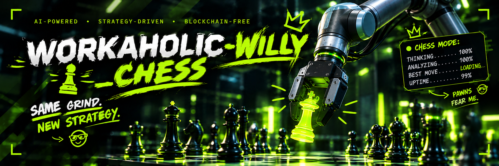

<!-- ────────────────────────────────────────────────────────────────────────── -->
<div align="center">



<br>

**Say _what_ to pick. Willy perceives it, plans a collision-free 6-DoF grasp, gates every motion through
a fail-closed safety pipeline, executes on a real or simulated arm, then checks the hold, recovers and logs.**

<br>
</div>
<!-- ────────────────────────────────────────────────────────────────────────── -->

## 🚀 Quick Start

**Validated on Windows 10&11, Python 3.11**

```bash
git lfs install                      # once per machine: the detector weights in docs/weights come through Git LFS
python3.11 -m venv .venv             # Windows: py -3.11 -m venv .venv
source .venv/bin/activate            # Windows: .\.venv\Scripts\Activate.ps1
git clone https://github.com/ManterJochen/Workaholic-Willy.git external/Workaholic-Willy
pip install -r requirements.txt      # everything, with CUDA torch wheels that also import without a GPU
                                     # macOS / no NVIDIA GPU: pip install -r requirements-cpu.txt
pip install -e .\external\Workaholic-Willy --no-deps
```

On macOS `pyrealsense2` and `ur_rtde` have no wheels; leave them out for desk work (the cell needs them).

## ♟️ Playing

1. Train the piece detector once, on the workstation (YOLO set in `data/`, weights land in `docs/weights/`):
   ```bash
   python -m src.pieces.train                 # --smoke first to check the setup
   ```
2. Set up the starting position and check that Willy's board lies where the real one does: the grasp
   centre stops above a3, h3, h6, a6 and e5 one after the other.
   ```bash
   python -m src.game.touch_test --willy-data <Willy config directory of your cell>
   ```
3. Play (Willy calibrates the board from the starting position):
   ```bash
   python main.py --willy-data <Willy config directory of your cell>
   ```
   W / S: your colour. Space bar: your move is done. R: calibrate again. A: resign. U: offer a draw (Willy
   accepts unless it stands better). Click two squares: enter a move by hand. Esc: end.

Every finished game is saved as PGN in `data/games/`. Willy waits while a hand is over the board, names a
move the rules forbid, and checks each of its own moves with the camera. The live view of the board
detection alone (saddle points, lattice, projected chessboard): `python -m src.board.demo`.

With `record.enabled: true` every confirmed view is saved as YOLO training data (`data/recorded/`), the
classes taken from the tracked position: images from exactly the robot's point of view.

The cell (camera, hand-eye calibration, look poses, robot, hand) comes from Willy's config directory, given
with `--willy-data` or once as `willy.data_dir` in the config; the game from
[`config/willy_chess.yaml`](config/willy_chess.yaml), for example `game.promotion_mode` (no spare queen:
the pawn stays and counts as the new piece), `engine.elo` (Willy's strength, 1320..3190) or the graveyard.

## 🧭 How it works

| Stage | Code | What it does |
| --- | --- | --- |
| 1-2 Corners, grid | [`src/board/grid.py`](src/board/grid.py) | saddle points + cornerSubPix, lattice, side-or-diagonal test, RANSAC in pixels, 8x8 window from the board edge |
| 3 Calibration | [`src/mapping/calibration.py`](src/mapping/calibration.py) | mirror, rotation and window from the pieces of a known position, a1 parity, square size from the depth, piece set |
| 4 Piece to square | [`src/mapping/pieces.py`](src/mapping/pieces.py) | foot point on the viewing ray, depth estimate, censored fusion, Hungarian assignment |
| 3D board | [`src/mapping/chessboard_mapping_3d.py`](src/mapping/chessboard_mapping_3d.py) | `ChessBoardMapping3D`: grab with camera pose (wrist or fixed), board locked in the robot base frame, pose correction per view, moved-board check, detector only on the board |
| 5 Moves | [`src/game/tracker.py`](src/game/tracker.py) | legal moves as candidates, NLL with a gate on the geometry, own moves verified, physical vs. logical pieces |
| Robot | [`src/game/robot_moves.py`](src/game/robot_moves.py) | a move as pick/place transfers (captures, castling, en passant), jaw direction with the most room |
| Game, UI | [`src/game/game.py`](src/game/game.py), [`src/ui/pygame_view.py`](src/ui/pygame_view.py) | turns, questions instead of guesses, Pygame view |

## 🔌 Where Workaholic-Willy is used

| Willy | Where | What for |
| --- | --- | --- |
| `load_tree(None, root=<data dir>)`, `CameraWorldPlan`, `tree.robot.look_joint_positions_deg`, `robot.grasping.gripper_geometry` | [`src/game/play.py`](src/game/play.py), [`robot_moves.py`](src/game/robot_moves.py) | the cell: cameras, whether the arm plans with a camera world, look pose, finger size |
| `Camera` (`grab`, `get_intrinsics`, `get_distortion`, `calibration`) | [`chessboard_mapping_3d.py`](src/mapping/chessboard_mapping_3d.py) | colour + aligned depth, lens, hand-eye calibration |
| `ShutterStamp`, `camera_to_base_at_shutter` | `WillyCameraPose` in [`chessboard_mapping_3d.py`](src/mapping/chessboard_mapping_3d.py) | where the camera stood for each frame, wrist or fixed |
| `ObjectDetector.from_weights(...).detect(segment=True)` | [`play.py`](src/game/play.py), `ChessBoardMapping3D` | pieces with SAM2 masks, on the board crop only |
| `DetectorTraining` | [`src/pieces/train.py`](src/pieces/train.py) | training the piece detector |
| `Robot`: `connected`, `home`, `move_joints`, `move`, `tool_down`, `pick`, `place`, `release` | [`robot_moves.py`](src/game/robot_moves.py), [`play.py`](src/game/play.py), [`touch_test.py`](src/game/touch_test.py) | every motion, gated by Willy's safety |
| `SegmentationOffer` | `RobotMover` in [`robot_moves.py`](src/game/robot_moves.py) | with a camera world: the piece to grip held out of it, the others as named obstacles |

## 🧪 Tests and benchmark

```bash
cd tests
python -m unittest test_robot_moves test_mapping_sim test_game_sim test_willy_integration -v
python -m bench.run --write-baseline bench/baseline_local.json                  # reference, once per machine
python -m bench.run --adapter bench/adapters/willy_chess.py --baseline bench/baseline_local.json
```

## Repositories used in here

- [Workaholic-Willy](https://github.com/ManterJochen/Workaholic-Willy)
- [Stockfish](https://github.com/official-stockfish/Stockfish)
- [Chessboard](https://github.com/Elucidation/ChessboardHarmonicDetect)
- [Chessboard-ML](https://github.com/Elucidation/ChessboardDetect)