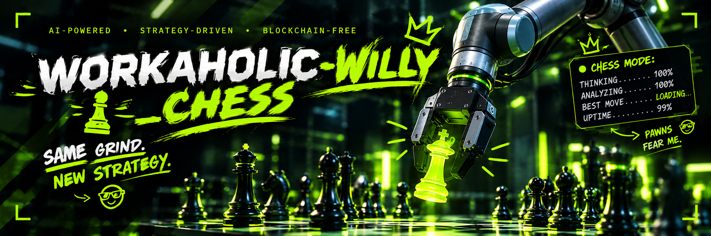

<!-- ────────────────────────────────────────────────────────────────────────── -->
<div align="center">



<br>

**Play chess without lifting a finger. Stockfish makes the moves, Willy brings them to life. For all those guys who suck at chess
but want to beat their friends.**

<br>
</div>
<!-- ────────────────────────────────────────────────────────────────────────── -->

## 🚀 Quick Start

**Validated on Windows 10&11, Python 3.11**

```bash
git lfs install                      # For weight fetching
python3.11 -m venv .venv             # Windows: py -3.11 -m venv .venv
source .venv/bin/activate            # Windows: .\.venv\Scripts\Activate.ps1
git clone https://github.com/ManterJochen/Workaholic-Willy.git external/Workaholic-Willy
pip install -r requirements.txt
pip install -e .\external\Workaholic-Willy --no-deps
python -m src.pieces.fetch           # RT-DETR base + SAM2 + MediaPipe hand (1.1 GB)
```

Everything from an empty machine to the first game, step by step: [docs/setup.md](docs/setup.md).

## ♟️ Playing

1. Train the piece detector once, on the workstation (For trainingset ask the maintainer):
   ```bash
   python -m src.pieces.train                 # --smoke first to check the setup
   ```
2. Set up the starting position and check that Willy's board lies where the real one does: the grasp
   centre stops above a3, h3, h6, a6 and e5 one after the other, then above the corners of the graveyard.
   `--corners` also goes down to a1, h1, h8 and a8, where the arm reaches furthest (take the rooks off when it asks).
   ```bash
   python -m src.game.touch_test --willy-data <Willy config directory of your cell>
   ```
3. Play (Willy calibrates the board from the starting position):
   ```bash
   python main.py --willy-data <Willy config directory of your cell>
   ```
   W / B: your colour. Space bar: your move is done. R: calibrate again. G: resign. D: offer a draw (Willy
   accepts unless it stands better). Q / R / B / N: the promotion piece. Click two squares: enter a move by
   hand. F: the board is right, play on (offered when the camera keeps disagreeing with Willy's move). Esc: end.

Every game is saved as PGN in `data/games/`, a crashed one too. Willy waits while a hand is over the board, names a
move the rules forbid, and checks each of its own moves with the camera. The live view of the board
detection alone (saddle points, lattice, projected chessboard): `python -m src.board.demo`.

Every game keeps a log in `data/game_logs/<start time>/`: each view (image, depth, masks, pose), what the tracker made
of it, every question and answer, Stockfish's moves and what the arm did (`record.enabled`). A strange moment can be looked
at again with `read_game` and `load_view` from [`src/pieces/record.py`](src/pieces/record.py), and the games become a
training set from exactly the robot's point of view:

```bash
python -m src.pieces.export                                     # data/game_logs -> data/cell_dataset
python -m src.pieces.train --data data/cell_dataset --base-model docs/weights/chess_pieces_rtdetr/last --epochs 10 --batch 24 --out docs/weights/chess_pieces_v3
```

The labels come from the game, so a piece the detector named wrongly or missed is labelled right, and a move only a click
could settle comes along; these count three times in training (`--hard-repeat`), drawn in `preview/`. The depth has to
agree with the position: views it contradicts (a hand, a wrong move before it was taken back) go to `review/` with the
reason in `reasons.txt`. Every fifth game goes to validation whole. A few games are few against the 9218 images of the
first training: to train on both, copy `train/` and `val/` into that dataset, the file names do not collide.

The cell (camera, hand-eye calibration, look poses, robot, hand) comes from Willy's config directory, given
with `--willy-data` or once as `willy.data_dir` in the config; the game from
[`config/willy_chess.yaml`](config/willy_chess.yaml), for example `game.promotion_mode` (no spare queen:
the pawn stays and counts as the new piece), `engine.elo` (Willy's strength, 1320..3190) or the graveyard.

### Checking the cell, and several look poses

```bash
python -m src.game.detect_test                 # what the detector finds in one view
python -m src.game.mapping_test                # the square and the position error of every piece
python -m src.game.mapping_test --all-looks    # one view from every look pose: board in the picture? does it stay put?
python -m src.game.mapping_test --save         # also keep every view (image, depth, masks, pose) as an .npz
```

The game looks from `robot.motion.look_deg[0]`, which may be the home pose. With `game.look_views` above 1 (wrist camera
only) a refused calibration, a move that is not recognised and a move of Willy's that is not confirmed are looked at
from the next pose, by way of the first, before anybody is asked. Set it once `--all-looks` shows the whole board and
a board that stays where it is from every pose: every piece out of the picture costs 1 of the tracker's gate of 10.

### The detector's weights

The weights in `docs/weights/chess_pieces_rtdetr` were trained with `transformers` 5.5.4, whose main loss matched
RT-DETR's last decoder layer against the denoising queries
([PR 48528](https://github.com/huggingface/transformers/pull/48528), released in 5.18). That layer ranks the pieces
right but scores them 0.02 to 0.1, and it adds nothing to the boxes, so this checkpoint runs without it:
`"decoder_layers": 5` in its `config.json`. The load report lists the unused weights as `UNEXPECTED`, which is expected.

Willy's trainer repairs the loss and its report says `SCORES COLLAPSED` if a run has the fault anyway; a model trained
with it needs no such setting. To replace these weights, with the repaired Willy, on the workstation:

```bash
python -m src.pieces.train --base-model docs/weights/chess_pieces_rtdetr/last --epochs 10 --batch 24 --out docs/weights/chess_pieces_v2   # about 1 h
python -m src.pieces.train --batch 24 --out docs/weights/chess_pieces_v2                                                                 # about 5 h, from the COCO base
```

Then point `detector.weights` at the new folder. `last/` is the one to continue from: it still has its 6 layers.

## 🧭 How it works

The math behind every stage, explained step by step: [docs/board_detection_math.md](docs/board_detection_math.md).

| Stage | Code | What it does |
| --- | --- | --- |
| 1-2 Corners, grid | [`src/board/grid.py`](src/board/grid.py) | saddle points + cornerSubPix, lattice, side-or-diagonal test, RANSAC in pixels, 8x8 window from the board edge |
| 3 Calibration | [`src/mapping/calibration.py`](src/mapping/calibration.py) | mirror, rotation and window from the pieces of a known position, a1 parity, square size from the depth, piece set |
| 4 Piece to square | [`src/mapping/pieces.py`](src/mapping/pieces.py) | foot point on the viewing ray, depth estimate, censored fusion, Hungarian assignment |
| 3D board | [`src/mapping/chessboard_mapping_3d.py`](src/mapping/chessboard_mapping_3d.py) | `ChessBoardMapping3D`: grab with camera pose (wrist or fixed), board locked in the robot base frame, pose correction per view, moved-board check, detector only on the board |
| 5 Moves | [`src/game/tracker.py`](src/game/tracker.py) | legal moves as candidates, NLL with a gate on the geometry, own moves verified, physical vs. logical pieces |
| Robot | [`src/game/robot_moves.py`](src/game/robot_moves.py) | a move as pick/place transfers (captures, castling, en passant), jaw direction with the most room |
| Game, UI | [`src/game/game.py`](src/game/game.py), [`src/ui/pygame_view.py`](src/ui/pygame_view.py) | turns, questions instead of guesses, Pygame view |

## 🔌 Where Workaholic-Willy is used

| Willy | Where | What for |
| --- | --- | --- |
| `load_tree(None, root=<data dir>)`, `CameraWorldPlan`, `tree.robot.motion.look_deg`, `jaw_envelope(tree.robot)` | [`src/game/play.py`](src/game/play.py), [`robot_moves.py`](src/game/robot_moves.py) | the cell: cameras, whether the arm plans with a camera world, look pose, finger size |
| `Camera` (`grab`, `get_intrinsics`, `get_distortion`, `calibration`) | [`chessboard_mapping_3d.py`](src/mapping/chessboard_mapping_3d.py) | colour + aligned depth, lens, hand-eye calibration |
| `capture` | `WillyCameraPose` in [`chessboard_mapping_3d.py`](src/mapping/chessboard_mapping_3d.py) | each frame with where the camera stood, wrist or fixed, the arm asked to stand still first, the depth the median of a burst |
| `ObjectDetector.from_weights(...).detect(segment=True)` | [`play.py`](src/game/play.py), `ChessBoardMapping3D` | pieces with SAM2 masks, on the board crop only |
| `DetectorTraining`, `DetectorPlanOverrides` | [`src/pieces/train.py`](src/pieces/train.py) | training the piece detector |
| `scripts/model_weights/fetch.py` | [`src/pieces/fetch.py`](src/pieces/fetch.py) | RT-DETR base, SAM2 and the MediaPipe hand bundle into Willy's assets, TLS through the OS trust store (truststore) |
| `build_palm_detector(weights_root=...).observe(bgr)` (`src.models.handdetection`) | [`play.py`](src/game/play.py), `ChessBoardMapping3D` | a hand anywhere in the picture stops Willy's move (`game.hand_detection`) |
| `Robot`: `connected`, `home`, `move_joints`, `move`, `tool_down`, `pick`, `place`, `release` | [`robot_moves.py`](src/game/robot_moves.py), [`play.py`](src/game/play.py), [`touch_test.py`](src/game/touch_test.py) | every motion, gated by Willy's safety |
| `SegmentationOffer` | `RobotMover` in [`robot_moves.py`](src/game/robot_moves.py) | with a camera world: the piece to grip held out of it, the others as named obstacles |

## 🧪 Tests and benchmark

```bash
cd tests
python -m unittest test_robot_moves test_mapping_sim test_game_sim test_game_log test_regressions test_willy_integration -v
python -m bench.run --write-baseline bench/baseline_local.json                  # reference, once per machine
python -m bench.run --adapter bench/adapters/willy_chess.py --baseline bench/baseline_local.json
```

## Repositories used in here

- [Workaholic-Willy](https://github.com/ManterJochen/Workaholic-Willy)
- [Stockfish](https://github.com/official-stockfish/Stockfish)
- [Chessboard](https://github.com/Elucidation/ChessboardHarmonicDetect)
- [Chessboard-ML](https://github.com/Elucidation/ChessboardDetect)