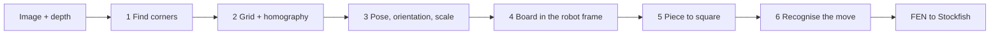

# How Willy sees the chessboard – the math, explained

This page walks through everything that happens between "the camera takes a picture" and "Stockfish gets a
position". Each stage starts with the idea in plain words, then the math, then a pointer into the code. You don't
have to read it in one go: every section stands on its own.

| Stage | Code |
| --- | --- |
| 1 Corners | [`src/board/saddle.py`](../src/board/saddle.py) |
| 2 Grid | [`src/board/grid.py`](../src/board/grid.py), [`src/board/symetric_solver.py`](../src/board/symetric_solver.py) |
| 3 Calibration | [`src/mapping/calibration.py`](../src/mapping/calibration.py), [`src/mapping/geometry.py`](../src/mapping/geometry.py) |
| 4 Board in the robot frame | [`src/mapping/chessboard_mapping_3d.py`](../src/mapping/chessboard_mapping_3d.py) |
| 5 Piece to square | [`src/mapping/pieces.py`](../src/mapping/pieces.py) |
| 6 Moves | [`src/game/tracker.py`](../src/game/tracker.py), [`src/game/game.py`](../src/game/game.py) |

A few conventions used everywhere ([`geometry.py`](../src/mapping/geometry.py)):

- **Board frame:** origin in the middle of the board, $x$ points towards the h-file, $y$ towards the 8th rank,
  $z$ up, everything in metres. The centre of square $(f, r)$ sits at $\big((f-3.5)\,s,\ (r-3.5)\,s\big)$, where
  $s$ is the square size.
- **Camera:** $X_\text{camera} = R\,X_\text{board} + t$, and $K$ is the camera matrix (focal length and image
  centre).
- **Squares** are numbered as in python-chess: a1 = 0 up to h8 = 63.

---

## 1 · Finding corners: saddle points

**The idea.** Where four squares meet, the image looks like a saddle: two opposite squares bright, two dark. These
"X-corners" are what we look for, because they sit on a perfect grid.

**The math.** Near an X-corner the brightness behaves like $f(x, y) \approx c\,xy$. Its second derivative, the
Hessian, is then

$$
\mathbf H = \begin{pmatrix} f_{xx} & f_{xy} \\ f_{xy} & f_{yy} \end{pmatrix}
          = \begin{pmatrix} 0 & c \\ c & 0 \end{pmatrix},
\qquad \det \mathbf H = -c^2 < 0 .
$$

A negative $\det \mathbf H$ means "saddle" (a bright spot or a dark hole would give a positive one). So
$-\det \mathbf H$ is our corner score: the larger, the clearer the corner. After that:

- **Keep only local maxima** (non-maximum suppression in an 11 × 11 window) above a minimum response.
- **Check the symmetry:** a real X-corner looks the same after a 180° turn. On a ring of 40 pixels, 5 px around
  the point, brightness and gradient strength are compared with their copy turned by 180° (normalised
  cross-correlation ≥ 0.2, gradient symmetry ≥ 0.02). Plain edges, blobs and texture drop out here.

**Subpixel accuracy (Förstner).** The pixel grid is too coarse, we want fractions of a pixel. The trick: at the true
corner $\mathbf q$, every image gradient $\mathbf g_i$ nearby is perpendicular to the direction towards the pixel
$\mathbf p_i$. Either the pixel lies on an edge through the corner, or inside a flat square where
$\mathbf g_i \approx 0$. That gives a small linear system over all pixels in a window:

$$
\hat{\mathbf q} = \arg\min_{\mathbf q} \sum_i \big(\mathbf g_i^\top (\mathbf q - \mathbf p_i)\big)^2
\quad\Longrightarrow\quad
\Big(\sum_i \mathbf g_i \mathbf g_i^\top\Big)\,\hat{\mathbf q} = \sum_i \mathbf g_i \mathbf g_i^\top\,\mathbf p_i .
$$

This is OpenCV's `cornerSubPix`. The window has to stay smaller than half a square, or it sees the next corner as
well. Rule of thumb: half window $\approx 0.12 \times$ the shortest square side in the image. We measure that side as
the median distance of each corner to its nearest neighbour, because the nearest neighbour always lies along the
more foreshortened board axis.

> **Why not the old Newton step any more?** The Newton step $\mathbf d = -\mathbf H^{-1}\mathbf g$ is derived
> correctly, but a 3 × 3 Sobel filter scales every derivative by 8. Applied twice, $\mathbf g \to 8\mathbf g$ and
> $\mathbf H \to 64\mathbf H$, so the step comes out eight times too short:
> $-(64\mathbf H)^{-1}(8\mathbf g) = \tfrac18\,\mathbf d$. In a simulated test the corner error (RMSE) was 0.42 px
> without refinement, 0.35 px with the old step, 0.14 px with the step times 8 and 0.08 px with `cornerSubPix`.

**In the code:** [`SaddlePointDetector`](../src/board/saddle.py) – `_get_saddle` (Hessian),
`_filter_saddle_points` (symmetry), `_refine_subpixel` and `_adaptive_win` (Förstner).

---

## 2 · From a cloud of points to a grid

**The idea.** We now have lots of points: the real board corners, but also noise from carpet, shelves or wood grain.
If the real corners lie on a grid, then every **displacement** between two of them is a grid vector too. Where
certain displacements pile up, we have found the grid directions.

**The displacement histogram.** If the corners sit at $\mathbf p_i = \mathbf o + B\,\mathbf n_i$ with integer
$\mathbf n_i$ and basis $B$ (two column vectors), then

$$
\mathbf p_i - \mathbf p_j = B\,(\mathbf n_i - \mathbf n_j)
$$

is a grid vector again. A 2D histogram of all pairwise displacements therefore has peaks exactly on the grid vectors
(crystallographers call this the Patterson function). The shortest, strongest peaks are the basis; their multiples
("harmonics") count in their favour.

> **Learned from real images:** the basis is estimated from the **60 strongest** corners only. With all points, a
> real room puts so many background displacements into the histogram that a diagonal often wins as an axis. On a
> webcam recording of a hand-held board, only 30 of 57 frames were right that way, with the strongest 60 it was
> 56 of 57 ([`BASIS_CORNERS`](../src/board/grid.py)).

**Grid coordinates.** Every point gets its coordinates in this basis, $\boldsymbol\ell_i = B^{-1}\mathbf p_i$. To put
the grid points on whole numbers, we subtract the common fractional part. Fractional parts live "on a circle"
(0.99 and 0.01 are neighbours), so we use the **circular mean**:

$$
\boldsymbol\delta = \frac{1}{2\pi}\arg\Big(\frac1N\sum_k e^{2\pi \mathrm i\,\boldsymbol\ell_k}\Big),
\qquad \boldsymbol\ell_k \leftarrow \boldsymbol\ell_k - \boldsymbol\delta .
$$

**Side or diagonal?** Every basis $B M$ with an integer $M$ and $\det M = \pm 1$ spans the same grid. So the diagonal
$\mathbf b_1 + \mathbf b_2$ would also be a "valid" basis, and seen from the side it is sometimes even shorter than a
board edge. A photometric test decides: the midpoint between two neighbouring corners lies exactly on an edge when
you step **along a board side**, and there the image gradient $\mathbf g$ is perpendicular to the step
$\hat{\mathbf t}$. Stepping **along a diagonal**, the midpoint lies in the middle of a square, with hardly any
gradient. For each direction $\mathbf e \in \{(1,0), (0,1), (1,1), (1,-1)\}$:

$$
s(\mathbf e) = \operatorname{median}\Big(\,|\mathbf g \times \hat{\mathbf t}| - |\mathbf g \cdot \hat{\mathbf t}|\,\Big)
\ \text{over the midpoints}.
$$

The winner is the pair of directions with $\det = \pm 1$ whose weaker direction scores best.

**The homography.** A flat board photographed at an angle is mapped by a **homography**: a 3 × 3 matrix $\mathbf H$
that maps grid points $(i, j)$ to pixels (in homogeneous coordinates, "up to a factor"):
$\tilde{\mathbf p} \simeq \mathbf H\,(i, j, 1)^\top$.

It is estimated with **RANSAC**: again and again, take four random pairs, compute $\mathbf H$ and count how many
other points agree with it. The crux is **where** you measure "agree". The noise of the corners lives in the image,
in pixels. So we fit **grid → image** and call a point an inlier when it lands within 2 px:

$$
\hat{\mathbf H} = \arg\min_{\mathbf H} \sum_{i \in \mathcal I} \big\|\mathbf p_i - \pi(\mathbf H\,\tilde{\mathbf n}_i)\big\|^2,
\qquad \mathcal I = \{\, i : \|\mathbf p_i - \pi(\mathbf H\,\tilde{\mathbf n}_i)\| < 2\ \text{px} \,\}.
$$

> **Why this mattered:** RANSAC used to run the other way (image → grid) with OpenCV's default threshold of 3,
> measured in grid units, i.e. **3 squares**. After rounding, a noise point is at most half a square away from
> "its" grid point, so it always counted as an inlier. If a random point lies uniformly in a grid cell, it passes a
> threshold $t$ (in squares) with probability $\pi t^2$: for sure at $t = 3$, only ~3 % at $t \approx 0.1$.

**Which 8 × 8 window?** A grid looks the same after any shift by whole squares. Only the edge of the board tells where
it starts. We try all sensible shifts $(c_x, c_y)$ and take

1. the one with the most inlier corners in the 7 × 7 window, and among those within 3 of the best
2. the one with the most **edge energy** on the 18 grid lines. In the right window every line lies on a real edge;
   a shifted window puts one line into the board's frame.

With fewer than 12 inliers the grid counts as not found. In our recordings, grids made up from shelves or floors had
at most 9 inliers, real boards at least 26.

**In the code:** [`detect_grid`](../src/board/grid.py) with `_lattice_coordinates`, `_choose_axes`, `_inliers` and
`_choose_window`; the histogram is in [`ChessboardSolver`](../src/board/symetric_solver.py). The idea of the
displacement histogram comes from [ChessboardHarmonicDetect](https://github.com/Elucidation/ChessboardHarmonicDetect).

---

## 3 · Calibration: pose, orientation and scale

### 3.1 From the homography to the pose

With the camera matrix $K$, the homography is tied to the real position of the board:

$$
\mathbf H \simeq K\,[\,\mathbf r_1\ \ \mathbf r_2\ \ \mathbf t\,],
\qquad \mathbf r_3 = \mathbf r_1 \times \mathbf r_2,
\qquad \mathbf C = -R^\top \mathbf t .
$$

$\mathbf r_1, \mathbf r_2$ are the first two columns of the rotation $R$, and $\mathbf C$ is the camera centre in
board coordinates. Instead of decomposing this by hand, we use `cv.solvePnP` with **IPPE** (made for planar targets)
and refine with Levenberg–Marquardt on the reprojection error (`solvePnPRefineLM`).

### 3.2 Which corner is a1? The 8 symmetries

The grid only knows its labelling "up to" the 8 symmetries of a square (4 rotations × mirror), plus shifts. Each one
needs its own evidence:

1. **Mirror:** the camera has to be **above** the board, so $C_z > 0$. If $C_z < 0$, the labelling is mirrored
   (a- and h-file swapped): flip the $x$ index and solve the pose again.
2. **Rotation and window from the pieces:** we calibrate in the starting position (or in any position the game
   currently knows). For all 4 rotations × 25 shifts we count how many visible pieces stand on a square of their
   **colour**, and in addition how many also have the right **type**. A detector almost always gets the colour right,
   the type not always, so both count. The winner needs a lead of at least 6 points, otherwise we refuse instead of
   guessing.
3. **Cross-check that a1 is dark:** per square, the median of the pixels no piece covers, compared with the
   chessboard pattern:

   $$
   s = \sum_{f,r} (-1)^{f+r}\,\big(\operatorname{median}_{f,r} - \operatorname{median}_\text{all}\big).
   $$

   If $s > 0$, the squares with an even $f + r$ would be light, so a1 would not be dark. Then the calibration is
   refused.

### 3.3 The square size comes from the depth

We never tell Willy how big the board is. PnP runs in **square units**, so the camera height comes out "in squares".
A plane through the depth points of the free board pixels gives the same height **in metres**. Their ratio is the
square size:

$$
\hat s = \frac{h_\text{depth}}{h_\text{squares}},
\qquad h_\text{squares} = \big|(-R^\top \mathbf t_\text{squares})_z\big|,
\qquad h_\text{depth} = |\mathbf n^\top \mathbf c_0| .
$$

The plane ($\mathbf n$ normal, $\mathbf c_0$ centroid) comes from a **singular value decomposition**: the normal is
the direction in which the points spread least. That minimises the perpendicular distances, which is right because
the noise sits in all coordinates. Outliers (beyond 3σ) are trimmed three times. Two cross-checks: the depth normal
and the board $z$ of the pose may differ by at most 3°, and in the end every piece has to land on a square of its
colour.

In the simulator, the square size measured this way was off by 0.2–0.3 % on average and by at most about 0.4 %. That
matters, because a wrongly assumed square size shifts all depth points by $(k-1)\,\mathbf C$ (about 9 cm at a
distance of 0.75 m and a 12 % error).

**In the code:** [`calibrate_board`](../src/mapping/calibration.py) with `_rank_labellings`, `_parity`,
`_square_from_depth`, `_measure_dims`; PnP and the plane fit are in [`geometry.py`](../src/mapping/geometry.py).

---

## 4 · The board in the robot's frame

**The idea.** After calibration we know the board relative to the camera. But Willy grasps in **its own**
coordinates. The wrist camera moves with the arm, so we remember the board in the robot base frame, where it stays
put as long as nobody moves it.

**The chain.** For every frame, Willy knows where the camera was: the tool pose at the moment of the shot times the
hand-eye calibration. So:

$$
{}^{\text{base}}\mathbf T_{\text{board}} = {}^{\text{base}}\mathbf T_{\text{tool}}(\mathbf q)\;
{}^{\text{tool}}\mathbf T_{\text{camera}}\;{}^{\text{camera}}\mathbf T_{\text{board}} .
$$

With a fixed camera, the tool term drops out. Willy's `ShutterStamp` reads the tool pose right before and after the
shot and takes the picture again if the arm moved in between.

**Every further view** predicts the board from this lock, backwards through the same chain. The visible corners
correct the prediction (kinematics and hand-eye calibration are never perfect):

- Detected corners are matched only near the prediction (within 0.35 squares), and corners on pieces are ignored
  (piece outlines create fake saddle points).
- Refine the pose starting from the prediction, drop outliers above 2 px, refine again.
- **Moved?** If the median residual is above 1.5 px or the board moved by more than 0.35 squares, Willy calibrates
  again. A special case: a board shifted by **exactly one square** puts every corner onto a neighbouring corner, so
  the corners notice nothing. Only the edge gives it away: we compare the edge energy of the line one square
  **outside** the board with the opposite edge line. Unshifted, the ratio was at most 0.66 in the simulator, shifted
  by one square at least 2.0.

Every confirmed view carries the lock along. Since every view is an **absolute** measurement, no error accumulates,
and a board that got nudged slightly is grasped where it is now.

**Square centres in 3D.** A pixel $\mathbf u$ defines a viewing ray $\mathbf r = K^{-1}\mathbf u$. Its intersection
with the board plane $\mathbf n^\top \mathbf X = d$ is

$$
\mathbf X = \frac{d}{\mathbf n^\top \mathbf r}\,\mathbf r .
$$

This is exact, because a homography maps points **on** the plane exactly. It also works on an occupied square, where
the depth pixel would otherwise hit the top of the piece. And instead of a single depth pixel, the board plane rests
on tens of thousands of them: random noise averages away like $\sigma/\sqrt N$.

**Only look at the board.** The piece detector only sees the image crop that the board volume (the board plus a bit
of margin, up to 1.3 × the tallest piece) projects to. That saves time and gives every piece more pixels. Before
that, the image is undistorted once (colour bilinear, depth nearest neighbour, so no invented depths appear between
two surfaces).

**In the code:** [`ChessBoardMapping3D`](../src/mapping/chessboard_mapping_3d.py) – `calibrate`, `observe`,
`_correct_pose`, `_window_shifted`, `board_to_base_mm`; the camera pose is in `WillyCameraPose`.

---

## 5 · Which piece stands on which square?

### 5.1 Why not just take the centre of the mask?

The homography only maps points **on** the board correctly. A point of a piece at height $z$ lies on a viewing ray
that hits the board **behind** the piece. With $d$ as the horizontal distance to the camera's foot point $F$ (the
point on the board right below the camera) and $h_c$ as the camera height (intercept theorem):

$$
\Delta = \frac{z\,d}{h_c - z} .
$$

At a 60° tilt, the mask centroid of a king sits at about $z \approx 4.7$ cm, which throws it back by about 9.5 cm,
almost **two squares**.

### 5.2 The foot point

Only the foot stands on the board. We map all mask pixels onto the board plane with the homography. Every point of
the body lands behind the piece; the point **closest to $F$** is the front edge of the foot, and that one really is
on the plane. One foot radius $r$ further along the viewing direction $\hat{\mathbf u}$ is the centre:

$$
\mathbf g^\ast = \arg\min_{\mathbf g} \|\mathbf g - F\|,
\qquad \hat{\mathbf x}_\text{foot} = \mathbf g^\ast + r\,\hat{\mathbf u},
\qquad \hat{\mathbf u} = \frac{\mathbf g^\ast - F}{\|\mathbf g^\ast - F\|}.
$$

Instead of the minimum we take the 2 % quantile, so a single wrong pixel can't move anything.

### 5.3 Even better with depth

Every mask pixel with depth becomes a 3D point on the piece (points below 4 mm are dropped, those are mostly
"flying pixels" at the mask edge). We split them relative to the viewing direction into sideways $\ell$ and along
$\lambda$. Since the camera only sees the **front** of the piece, every visible point lies
$\sqrt{r(z)^2 - (\ell - \hat\ell)^2}$ in front of the axis. That gives:

$$
\hat\ell = \operatorname{median}_i \ell_i,
\qquad
\hat\lambda = \operatorname{median}_i\Big(\lambda_i + \sqrt{\max\big(r(z_i)^2 - (\ell_i - \hat\ell)^2,\ 0\big)}\Big),
$$

with a rough truncated cone $r(z) = r\,(1 - 0.45\,z/h)$ as the piece model.

### 5.4 Censored fusion

If a piece in front hides the foot, the lowest visible point is higher up and lands **further back**. So the foot
point can only be wrong **away from the camera**, never towards it (a one-sided, "censored" measurement). That gives
a simple rule with $\tau = 6$ mm:

$$
\hat{\mathbf x} =
\begin{cases}
\hat{\mathbf x}_\text{depth} & \text{if } (\hat{\mathbf x}_\text{foot} - \hat{\mathbf x}_\text{depth})^\top \hat{\mathbf u} > \tau,\\
\hat{\mathbf x}_\text{foot} & \text{otherwise.}
\end{cases}
$$

For finding the **square** this is plenty. For **grasping** we take the depth estimate directly: in the simulator it
was off by 1.8 mm in the median (99 % below 4.1 mm), the foot point by 4.4 mm (99 % below 13.4 mm).

### 5.5 Every piece on exactly one square

Without any history (a single image), we assign the pieces to the 64 square centres $\mathbf m_j$ with the
**Hungarian algorithm**: every piece on exactly one square, every square at most one piece, with the smallest sum of
squared distances. Pieces more than 0.75 squares off the board (the captured ones beside it) are left out.

**In the code:** [`pieces.py`](../src/mapping/pieces.py) – `foot_xy`, `depth_xy`, `fuse`, `piece_positions`,
`assign_squares`.

---

## 6 · From the image to the move

**The idea.** Instead of guessing 64 squares with 13 possible states each, we use the rules of chess: since the last
image, the position can only have changed by **one legal move**. That's usually 20 to 40 candidates, plus "no move"
(in case someone just straightened a piece).

**How well does a candidate explain the image?** For each candidate position, we assign the seen pieces to the
expected ones of the same colour (Hungarian again) and add up a negative log-likelihood (NLL), with $\sigma = 0.3$
squares:

$$
\text{NLL}_\text{geo} = \sum_{\text{seen}} \frac{\|\hat{\mathbf x}_i - \mathbf m_{a(i)}\|^2}{2\sigma^2}
\;+\; \sum_{\text{not seen}} c_\text{hidden}(j),
\qquad
\text{NLL}_\text{class} = 4 \times \#\{\text{wrong piece type}\}.
$$

$c_\text{hidden}$ is cheap (1) if the piece **could** be hidden by other pieces there (less than 15 % of its model
would be visible), otherwise expensive (50).

**The important split.** The candidate with the smallest **sum** is chosen. But whether we trust it depends on the
**geometry** alone: $\text{NLL}_\text{geo} \le 10$, otherwise Willy asks instead of guessing. Why? Occupancy and
colour pin down every legal move; only a promotion needs the piece type. If a mixed-up piece class counted towards the
gate, almost every move would be thrown out: with 5 % confused classes, only 25 % of the moves were recognised that
way, with the gate on the geometry 99.6 %, without a single silently wrong move.

The **absolute** NLL is the signal here, not the gap to the second-best candidate: wrong moves are often "confidently
wrong".

**Willy's own moves** don't have to be recognised, only **confirmed**: the target position is known, so its NLL is
enough. If it is above the gate, a grasp went wrong or a piece fell over, and Willy stops.

**What the image doesn't show** is carried along by the tracking: side to move, castling rights, en passant and the
move counters. That's how Stockfish gets a complete FEN.

**In the code:** [`MoveTracker`](../src/game/tracker.py) – `step`, `verify`, `_nll`, `_visible_fraction`;
the explanation of illegal moves is `describe_wrong_move` in [`game.py`](../src/game/game.py).

---

## 7 · Safety net: a hand over the board

Before Willy evaluates a move or the arm starts moving, it checks the depth for anything above the board that isn't a
detected piece: all depth points more than 1.5 cm above the board and outside every piece mask. Sensor noise and
flying pixels are single pixels and get removed by a morphological opening (5 × 5); a hand is a big blob. From 300
pixels on, Willy asks. In the simulator: exactly 0 pixels without a hand, more than 6000 with one.

**In the code:** `BoardObservation.intruders` in [`chessboard_mapping_3d.py`](../src/mapping/chessboard_mapping_3d.py),
`_clear_view` in [`game.py`](../src/game/game.py).

---

## 8 · How we test it

- **Simulator benchmark** ([`tests/bench`](../tests/bench/README.md)): rendered boards with known ground truth, six
  suites from corners to move tracking, compared with a frozen reference using a Fisher test.
  `cd tests && python -m bench.run --adapter bench/adapters/willy_chess.py`.
- **Real recordings** ([`tests/test_recordings.py`](../tests/test_recordings.py)): webcam sequences in `data/demo/`
  (recorded with `python -m src.board.demo --record data/demo/<name>`). There is no ground truth: a grid counts as
  right when enough of its 49 predicted inner corners lie on a real saddle point. A grid shifted by one square puts 7
  of them onto the board edge, where there are none.
- **Simulated games** ([`tests/test_game_sim.py`](../tests/test_game_sim.py)): whole games with a fake robot that only
  moves a piece when it grasps close enough to it.

An honest note at the end: the simulator knows no specular highlights, no background clutter and no lens distortion.
A change that won there once lost on real images. That's why the test on real recordings always has the last word.

---

## Sources and further reading

- **ChessboardHarmonicDetect** and **ChessboardDetect** by Elucidation – saddle points and the displacement histogram:
  <https://github.com/Elucidation/ChessboardHarmonicDetect>, <https://github.com/Elucidation/ChessboardDetect>
- **Workaholic-Willy** – camera, hand-eye calibration, detector and safe motions:
  <https://github.com/ManterJochen/Workaholic-Willy>
- W. Förstner, E. Gülch: *A Fast Operator for Detection and Precise Location of Distinct Points, Corners and Centres of
  Circular Features*, 1987 – the subpixel corner (in OpenCV as
  [`cornerSubPix`](https://docs.opencv.org/4.x/dd/d1a/group__imgproc__feature.html)).
- T. Collins, A. Bartoli: *Infinitesimal Plane-Based Pose Estimation*, IJCV 2014 – IPPE, in OpenCV as
  [`solvePnP(..., SOLVEPNP_IPPE)`](https://docs.opencv.org/4.x/d5/d1f/calib3d_solvePnP.html).
- M. Fischler, R. Bolles: *Random Sample Consensus*, 1981 – RANSAC
  ([`findHomography`](https://docs.opencv.org/4.x/d9/d0c/group__calib3d.html)).
- H. W. Kuhn: *The Hungarian Method for the Assignment Problem*, 1955 – the assignment
  ([`scipy.optimize.linear_sum_assignment`](https://docs.scipy.org/doc/scipy/reference/generated/scipy.optimize.linear_sum_assignment.html)).
- G. Wölflein, O. Arandjelović: *Determining Chess Game State from an Image*, J. Imaging 2021 – parallax as the core
  problem of assigning pieces to squares.
- C. Matuszek et al.: *Gambit: An Autonomous Chess-Playing Robotic System*, ICRA 2011 – depth, comparing states and
  asking back as the normal case.
